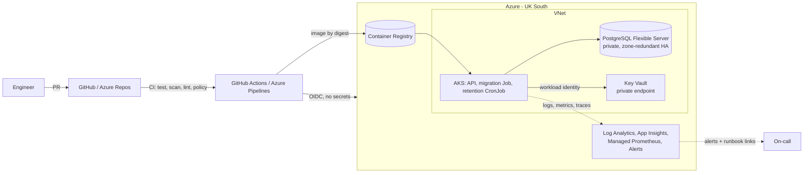

# MatterHub: a secure, observable Azure platform for a legal-matter API

MatterHub is a portfolio project that shows end-to-end DevOps practice on Microsoft Azure:
a small Python API, the infrastructure it runs on, the pipelines that ship it, and the
operational material (runbooks, SLOs, DR drills) that keeps it running.

The application is deliberately simple: it tracks legal matters through their lifecycle
with an append-only audit trail and a retention review job. The engineering around it is
the point.



## What is in the repo

| Area | Where | Highlights |
|---|---|---|
| Application | [`app/`](app/) | FastAPI, SQLAlchemy, Alembic; Entra ID RBAC; JSON logs with correlation IDs; Prometheus RED metrics; OpenTelemetry to App Insights; 44 tests, 97% coverage, strict mypy |
| Containers | [`app/Dockerfile`](app/Dockerfile), [`docker-compose.yml`](docker-compose.yml) | Multi-stage, hash-locked deps, non-root UID 10001, read-only root FS; local stack with Postgres, Prometheus, Grafana |
| Kubernetes | [`deploy/helm/matterhub/`](deploy/helm/matterhub/) | Deployment, HPA, PDB, NetworkPolicy, workload identity, Key Vault CSI, migration hook Job, CronJob, ServiceMonitor, `helm test`; Pod Security "restricted" |
| Terraform | [`infra/terraform/`](infra/terraform/) | 8 modules (network, AKS, ACR, Key Vault, PostgreSQL, monitoring, workload identity, alerts), dev and prod from the same code; write-only DB password never in state |
| Bicep | [`infra/bicep/`](infra/bicep/) | Subscription foundation: resource groups, Terraform state storage, Azure Policy, budget, Defender for Cloud |
| ARM | [`infra/arm/`](infra/arm/) | Log-search (KQL) alert rules as hand-written ARM JSON |
| GitHub Actions | [`.github/workflows/`](.github/workflows/) | CI with change detection, CD build-once/promote-by-digest, Terraform plan-on-PR/apply-saved-plan, Bicep what-if, weekly security scans, Dependabot |
| Azure DevOps | [`azure-pipelines/`](azure-pipelines/) | Same model with multi-stage YAML, templates, deployment jobs, environments with approvals and checks, `AzureResourceManagerTemplateDeployment@3` |
| Automation | [`scripts/`](scripts/) | Bash (kind cluster, smoke test, rollback, OIDC identity setup), PowerShell (secret rotation, tag compliance, DR restore drill + Pester tests), Python (release notes, AKS patching report + tests) |
| Observability | [`observability/`](observability/) | Prometheus SLO burn-rate alerts, Grafana dashboard, KQL query library |
| Operations | [`docs/`](docs/) | Architecture, ADRs, SLOs, security, DR, runbooks, postmortem template |
| Interview prep | [`docs/INTERVIEW_GUIDE.md`](docs/INTERVIEW_GUIDE.md) | Maps every requirement in the DevOps Engineer job description to this repo, with likely questions and scenarios |

## Job description coverage

| The role asks for | Shown here |
|---|---|
| CI/CD with Azure DevOps, GitHub Actions | [`.github/workflows/`](.github/workflows/), [`azure-pipelines/`](azure-pipelines/) |
| IaC with Bicep, ARM templates, Terraform | [`infra/bicep/`](infra/bicep/), [`infra/arm/`](infra/arm/), [`infra/terraform/`](infra/terraform/) and [ADR 0002](docs/adr/0002-terraform-bicep-and-arm.md) on when to use which |
| Secure Azure infrastructure | Private endpoints, NSGs, Entra-only auth, Azure Policy, Defender: [`docs/security.md`](docs/security.md) |
| Monitoring, logging, observability | [`observability/`](observability/), [`infra/terraform/modules/alerts/`](infra/terraform/modules/alerts/), [`docs/slo.md`](docs/slo.md) |
| Incidents, root cause, DR and business continuity | [`docs/runbooks/`](docs/runbooks/), [`docs/disaster-recovery.md`](docs/disaster-recovery.md), [`scripts/powershell/Invoke-DatabaseRestoreDrill.ps1`](scripts/powershell/Invoke-DatabaseRestoreDrill.ps1) |
| Secure by design, vulnerability remediation, patching, identity and secrets | Workload identity, OIDC, Key Vault CSI, Trivy, pip-audit, CodeQL, Dependabot, AKS auto-upgrade: [`docs/security.md`](docs/security.md) |
| Source control, branching, PRs, code review | [`CONTRIBUTING.md`](CONTRIBUTING.md), [`.github/pull_request_template.md`](.github/pull_request_template.md), [`.github/CODEOWNERS`](.github/CODEOWNERS) |
| PowerShell, Python, YAML, Bash automation | [`scripts/`](scripts/), every pipeline |
| Docker, Kubernetes | [`app/Dockerfile`](app/Dockerfile), [`deploy/`](deploy/) |
| Documentation, runbooks, support guides | [`docs/`](docs/) |

## Quick start

### 1. Run the API on your machine (2 minutes)

```bash
cd app
python -m venv .venv && source .venv/bin/activate
pip install -r requirements.txt -r requirements-dev.txt -e .
pytest --cov                                     # 44 tests
export MATTERHUB_AUTH_MODE=disabled
matterhub migrate && matterhub serve             # http://localhost:8000/docs
```

### 2. Full local stack with Docker Compose

```bash
cp .env.example .env
docker compose up --build
# API http://localhost:8000/docs  Prometheus http://localhost:9090  Grafana http://localhost:3000
docker compose run --rm retention                # run the retention job once
```

### 3. The real Helm chart on a local Kubernetes cluster (kind)

```bash
./scripts/kind-up.sh      # creates a 2-node cluster, builds, deploys, runs helm test + smoke test
./scripts/kind-down.sh
```

### 4. Deploy to Azure

| Step | Command | Who |
|---|---|---|
| 1. Foundation (RGs, state storage, policy, budget, Defender) | `az deployment sub create -l uksouth -f infra/bicep/main.bicep -p infra/bicep/main.bicepparam` | platform admin, once |
| 2. Pipeline identities (OIDC federated credentials) | `SUBSCRIPTION_ID=... GITHUB_REPO=org/matterhub ./scripts/setup-pipeline-identity.sh` | platform admin, once |
| 3. Infrastructure | merge to `main` → `infra` workflow plans, applies dev, waits for approval, applies prod | pipeline |
| 4. Namespace bootstrap (Pod Security, quota) | `kubectl apply -f deploy/cluster/namespace.yaml` | platform admin, once per cluster |
| 5. Application | merge to `main` → `cd` workflow builds, deploys dev, waits for approval, promotes and deploys prod | pipeline |

Prerequisites: Azure subscription, `az` CLI, Terraform >= 1.11 (write-only arguments),
`kubectl`, `kubelogin`, Helm 3. Register `Microsoft.Compute/EncryptionAtHost` once per subscription.

## How quality is enforced

Every pull request runs (only the parts it touches):

- **App**: ruff (including bandit security rules), ruff format, strict mypy, pytest with an 85% coverage gate, the full suite again against real PostgreSQL, pip-audit
- **Container**: hadolint, Trivy (fails on fixable HIGH/CRITICAL), a smoke test that runs the image read-only and checks it runs as UID 10001
- **Kubernetes**: `helm lint --strict`, render dev/prod/local, kubeconform against the Kubernetes 1.31 schema, Checkov
- **Terraform**: fmt, validate (dev and prod), tflint with the azurerm ruleset, Checkov
- **Bicep/ARM**: Bicep lint (warnings are errors), build to ARM, Checkov
- **Scripts**: shellcheck, PSScriptAnalyzer, Pester, pytest, actionlint
- **Secrets**: TruffleHog on the full history

All of these were run while building the project: 44 app tests (97% coverage), 11 script
tests, `terraform validate` for both environments against azurerm 5.x, Bicep build with no
linter warnings, kubeconform strict on every rendered manifest, Checkov with zero
unexplained findings (every skip in [`.checkov.yaml`](.checkov.yaml) has a reason).

## Repository layout

```text
app/                      FastAPI service, tests, Dockerfile, hash-locked requirements
deploy/helm/matterhub/    Helm chart (+ values-dev/prod/local, CI test values)
deploy/cluster/           One-off namespace bootstrap (Pod Security, quota, limits)
deploy/local/             kind cluster config and in-cluster PostgreSQL
infra/bicep/              Subscription foundation (Bicep)
infra/arm/                Log-search alert rules (ARM JSON)
infra/terraform/          modules/, stack/ (composition), envs/dev|prod
.github/                  Workflows, composite action, Dependabot, templates, CODEOWNERS
azure-pipelines/          Azure DevOps pipelines and templates
observability/            Prometheus rules, Grafana dashboard, KQL queries
scripts/                  Bash, PowerShell (module + Pester), Python (+ tests)
docs/                     Architecture, ADRs, SLOs, security, DR, runbooks, interview guide
```
