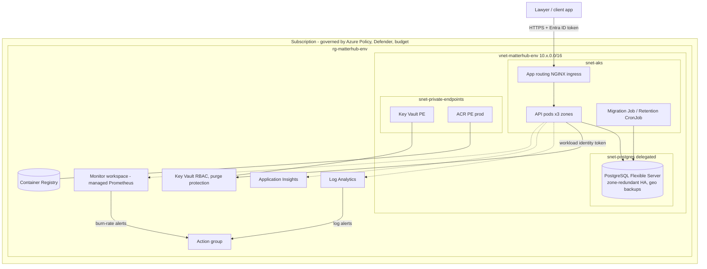
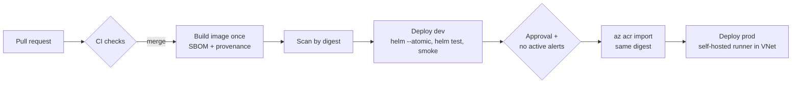

# Architecture

## Context

MatterHub records legal matters (cases) for government lawyers: who owns a matter, which
department it is for, its status, and an immutable audit trail of every change. Closed
matters must be reviewed when their retention period ends. Data is classified
**OFFICIAL / OFFICIAL-SENSITIVE** and must stay in the UK.

Quality attributes that drove the design, in priority order:

1. **Security**: identity-based access everywhere, no long-lived secrets, private data plane, auditability
2. **Reliability**: 99.5% availability SLO, zone redundancy in prod, tested restores
3. **Operability**: everything observable, every alert has a runbook, every change through a pipeline
4. **Cost**: dev is small and mostly public-endpoint; prod pays for private networking and HA

## Azure view (one environment)

## Request path

1. The client gets an access token from Entra ID for the MatterHub API app registration,
   with app roles (`Matters.Read`, `Matters.Write`, `Matters.Admin`).
2. The AKS application routing add-on (managed NGINX) terminates TLS with a certificate
   held in Key Vault. Only `/api/*` and `/version` are routed; `/metrics`, `/healthz`
   and `/readyz` are cluster-internal.
3. The API validates the token signature against Entra ID's JWKS, plus issuer, audience
   and expiry, and checks the role. It refuses to start in staging or prod with auth disabled.
4. Every request gets a correlation ID (`X-Request-ID`), is logged as one JSON line and
   counted in RED metrics labelled by route template.
5. Changes are written to `matters` and to the append-only `audit_events` table in the
   same transaction.

## Identity: no secrets anywhere

| Who | Authenticates to | How |
|---|---|---|
| Engineers | AKS, Azure | Entra ID + Azure RBAC; AKS local accounts disabled |
| Pipelines | Azure | OIDC federation (GitHub) / workload identity federation (Azure DevOps) |
| API pods | Key Vault | Workload ID: federated token for a user-assigned managed identity |
| AKS nodes | ACR | Kubelet managed identity with `AcrPull` |
| API | PostgreSQL | Password from Key Vault, mounted as a file by the CSI driver (never a K8s Secret) |

The only remaining password (PostgreSQL) is generated by Terraform as an ephemeral value,
passed to write-only arguments so it never reaches Terraform state, and rotated by
runbook. Moving to Entra ID authentication for PostgreSQL removes it entirely
(see the hardening backlog in [security.md](security.md)).

## Delivery

- The image is built once and promoted by **digest**, so prod runs exactly the bytes that
  were tested in dev.
- Database migrations run as a Helm **pre-upgrade hook**; if they fail, `--atomic` rolls
  the release back and the old pods keep serving.
- Infrastructure changes are planned on the PR (read-only identity), and the **saved plan**
  is what gets applied after approval.

## Environments

| | dev | prod |
|---|---|---|
| AKS | Free tier, public API (authorised IPs) | Standard tier (SLA), private API server |
| Node pools | 1-2 system, 1-3 user | 3-5 system, 3-9 user, across 3 zones |
| PostgreSQL | Burstable B1ms, 7-day backups | General Purpose, zone-redundant HA, 35-day backups, geo-redundant |
| ACR / Key Vault | Standard, public endpoint (Entra-only) | Premium + private endpoints, public access off |
| Deployment Safeguards | Warning | Enforcement |
| Pipeline runners | GitHub-hosted | Self-hosted inside the VNet |
| Approvals | none | 2 reviewers, business hours, no active Sev0/1 alerts |

## Decisions

See [adr/](adr/):

- [0001 Host on AKS](adr/0001-host-on-aks.md)
- [0002 Terraform for the workload, Bicep for the foundation, ARM where it fits](adr/0002-terraform-bicep-and-arm.md)
- [0003 No long-lived credentials](adr/0003-no-long-lived-credentials.md)
- [0004 Trunk-based development](adr/0004-trunk-based-development.md)
- [0005 Database migrations as a Helm hook](adr/0005-migrations-as-helm-hook.md)
